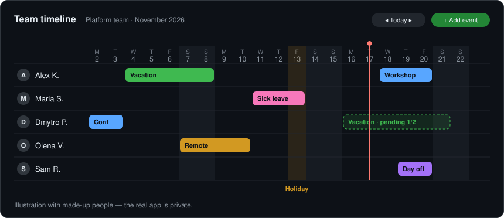

<div align="center">



[](https://t.me/bxsmxnjx)
[](https://github.com/Basmanjacks/uaanime/releases)
[](https://myretroboard.dev)

</div>

By day I design databases: schemas, warehouses, T-SQL that has to survive production.
By night I put on the cape and vibecode whole products with AI pair programmers —
a Go CLI, a realtime retro tool, a team absence tracker. Ship first, polish later.

## `$ ls -l ~/ships`

### 📺 [uaanime](https://github.com/Basmanjacks/uaanime) — anime in Ukrainian, straight from the terminal

<a href="https://github.com/Basmanjacks/uaanime"></a>

A Go TUI that remembers where you stopped (±5 s, even after `kill -9`), sticks to your favourite
dubbing studio, keeps a watchlist offline, shows new episodes and silently falls back when a video
host dies. No accounts, no telemetry.

```bash
brew tap Basmanjacks/uaanime
brew install --cask Basmanjacks/uaanime/uaanime
```

`Go` · `Bubble Tea` · `Lip Gloss` · `mpv / VLC` · `Homebrew tap` · `GoReleaser`

---

### 🃏 [Retro Board](https://myretroboard.dev) — retros and planning poker, in one place

<a href="https://myretroboard.dev"></a>

Realtime sprint retrospectives and planning poker. Create a board, share a secret link, and the
team joins instantly — no sign-up for participants. Cards, votes, comments, action items and
estimates update live for everyone.

`Next.js` · `TypeScript` · `Supabase Realtime` · `Tailwind` · `Vercel` · live at **[myretroboard.dev](https://myretroboard.dev)**

---

### 🗓️ Workforce — who is away, and when *(private)*



A team absence tracker built around one timeline: a row per person, a column per day, a bar per
absence. Approvals, vacation balances, company holidays, sprints, expenses with receipts,
Excel export, push and Microsoft Teams notifications, and a read-only REST API.

`Next.js 16` · `React 19` · `PostgreSQL 17` · `Prisma 7` · `Auth.js` · `Playwright` · `Docker`

## `$ cat stack.yml`

```yaml
day_job:
  role: database architect
  tools: [SQL Server, T-SQL, PostgreSQL, data warehouses, Liquibase]

night_shift:
  role: vibecoder
  langs: [Go, TypeScript, SQL, Bash]
  web: [Next.js, React, Tailwind, Supabase, Prisma]
  ops: [Docker, Vercel, GitHub Actions, Homebrew taps]
  pair_programmers: [Claude Code, Codex]
  motto: "it works on my machine, and my machine is fast"
```

<p align="center">
  
</p>

## `$ tail -f contributions.log`

<picture>
  <source media="(prefers-color-scheme: dark)" srcset="https://raw.githubusercontent.com/Basmanjacks/Basmanjacks/output/github-snake-dark.svg">
  <source media="(prefers-color-scheme: light)" srcset="https://raw.githubusercontent.com/Basmanjacks/Basmanjacks/output/github-snake.svg">
  
</picture>
